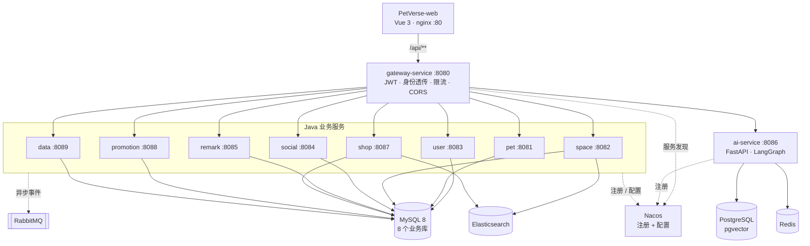

<div align="center">

# PetVerse · 宠域

**Java + Python 混合微服务的宠物社区平台后端**

真实宠物档案 · 宠域空间 · 好友私聊 · 点赞评论 · 周边商城 · AI 养宠顾问

[](https://openjdk.org/)
[](https://spring.io/projects/spring-boot)
[](https://spring.io/projects/spring-cloud)
[](https://www.python.org/)
[](https://fastapi.tiangolo.com/)
[](https://www.langchain.com/langgraph)
[](https://vuejs.org/)
[](https://github.com/374426703/PetVerse/pulls)

**前端仓库**：[374426703/PetVerse-web](https://github.com/374426703/PetVerse-web)

</div>

---

## 项目简介

PetVerse（宠域）后端覆盖账号与角色、虚拟宠物养成、真实宠物档案、宠域空间、好友私聊、点赞评论与通知、周边商城、优惠券、数据中台，以及 AI 养宠顾问。

Spring Cloud Gateway 作为统一入口，负责 JWT 鉴权、身份透传、限流与 CORS；8 个 Java 业务服务各自使用独立数据库，通过 Nacos 完成注册发现与配置下发，RabbitMQ 承载异步链路。AI 能力由独立的 Python 服务（FastAPI + LangGraph）提供，经网关 `/api/ai/**` 对外。

## 视频介绍

https://github.com/user-attachments/assets/7f25f5d1-a1be-4c64-9050-2ed45abeb2d7

## 快速开始

前置条件：

- Docker 24+ 与 Compose v2。
- `PetVerse-web` 与 `PetVerse` 位于同一父目录（compose 的 `web` 构建上下文是 `../PetVerse-web`）。
- `ai-service/.env` 必须存在，compose 强依赖该文件。

### 1. 准备配置

```bash
cp ai-service/.env.example ai-service/.env
```

在 `.env` 中至少配置对话与向量模型：

```dotenv
LLM_API_KEY=sk-xxx
LLM_BASE_URL=https://api.deepseek.com/v1
LLM_MODEL=deepseek-chat

EMBEDDING_API_KEY=sk-xxx
EMBEDDING_BASE_URL=https://dashscope.aliyuncs.com/compatible-mode/v1
EMBEDDING_MODEL=text-embedding-v3
```

- 不填 LLM Key 时设 `MOCK_CHAT=true`，对话走内置模拟回复。
- 不填 Embedding 时知识类提问直接报错，不做无依据作答。
- `.env` 里的 `PG_*`、`REDIS_*`、`NACOS_SERVER_ADDR` 由 compose 覆盖为容器地址，保留示例值即可。

### 2. 启动

```bash
docker compose -f docker-compose.micro.yml up -d --build
```

启动过程会自动完成：

1. `mysql-init` 创建 8 个 `petverse_*` 库并导入各服务 `db/schema.sql`。
2. `nacos-init` 把 `nacos-config/*.yml` 全量推送到 Nacos（dataId = 文件名去掉 `.yml`）。
3. 业务服务在初始化任务成功后启动，通过 Nacos 读取端口、数据源、OSS、MQ 等配置。
4. `postgres` 首次启动时执行 `ai-service/db/schema_pgvector.sql`，启用 pgvector。
5. `web` 由 `PetVerse-web` 构建，nginx 的 `/api` 反代到网关（网络别名 `app`）。

首次构建需拉取 Maven、npm、pip 依赖，耗时取决于网络。

### 3. 访问

| 地址 | 服务 |
|---|---|
| http://localhost | 前端 |
| http://localhost:8080/api/... | 网关 |
| http://localhost:8848/nacos | Nacos 控制台 |
| http://localhost:15672 | RabbitMQ 管理台（`petverse` / `petverse123`） |
| http://localhost:9200 | Elasticsearch |

MySQL、Redis、PostgreSQL 与 ai-service 未映射宿主机端口，仅容器网络内可达。

### 4. 导入知识库

```bash
docker compose -f docker-compose.micro.yml exec ai-service \
  python -m scripts.ingest_knowledge
docker compose -f docker-compose.micro.yml exec ai-service \
  python -m scripts.ingest_knowledge --stats
```

镜像内已包含 `app/knowledge` 语料（21 篇 md + 1 篇 pdf + 1 篇 docx）。

### 5. 设为管理员

初始化脚本不创建账号。先在前端注册，再改 `petverse_user` 库中的角色：

```bash
docker compose -f docker-compose.micro.yml exec mysql \
  mysql -uroot -p123456 petverse_user \
  -e 'UPDATE `user` SET role="ADMIN" WHERE username="your_name";'
```

密码取 `MYSQL_ROOT_PASSWORD`。改完重新登录，令牌中的角色声明才会更新。

### 环境变量

变量都有默认值，需要在 `PetVerse/` 下新建 `.env` 覆盖：

| 变量 | 默认值 | 用途 |
|---|---|---|
| `MYSQL_ROOT_PASSWORD` | `123456` | MySQL root 密码，业务服务共用 |
| `REDIS_PASSWORD` | `123456` | Redis 密码 |
| `RABBITMQ_USERNAME` / `RABBITMQ_PASSWORD` | `petverse` / `petverse123` | RabbitMQ 账号 |
| `PG_USER` / `PG_PASSWORD` | `petverse` / `petverse123` | PostgreSQL 账号 |
| `JWT_SECRET` | 配置文件内置值 | 令牌签名密钥，生产必须替换 |
| `INTERNAL_TOKEN` | 配置文件内置值 | 服务间调用令牌，须与 ai-service 一致 |
| `OSS_ENDPOINT` / `OSS_ACCESS_KEY_ID` / `OSS_ACCESS_KEY_SECRET` / `OSS_BUCKET_NAME` | 空 | 不配置时头像、动态媒体、商品图、聊天附件等上传不可用 |

### 常用命令

```bash
docker compose -f docker-compose.micro.yml ps
docker compose -f docker-compose.micro.yml logs -f gateway-service
docker compose -f docker-compose.micro.yml logs -f ai-service
docker compose -f docker-compose.micro.yml up -d --build user-service
docker compose -f docker-compose.micro.yml down
docker compose -f docker-compose.micro.yml down -v    # 连数据卷一起删除
```

## 系统架构



前端只访问网关，网关路由带 `StripPrefix=1`，业务服务内部路径不含 `/api`。AI 服务自注册到 Nacos，网关按 `lb://ai-service` 转发；AI 调用业务接口时同样取健康实例，并携带 `X-Internal-Token` 与 `X-User-Id`。

## 模块

| 模块 | 端口 | 存储 | 职责 |
|---|---|---|---|
| `gateway-service` | 8080 | — | 路由转发、JWT 校验、剥离并重注入身份头、游客只读放行、`/internal/**` 拦截、角色校验、令牌桶限流 |
| `user-service` | 8083 | `petverse_user` | 注册登录、资料头像、角色管理、内部批量查询；消费商家事件升降级 |
| `pet-service` | 8081 | `petverse_pet` + Redis db1 | 虚拟宠物等级经验、签到、真实宠物档案与健康信息、图鉴、身份卡 |
| `space-service` | 8082 | `petverse_space` + ES | 动态、可见性、点赞评论聚合、热度榜、全文检索与降级 |
| `social-service` | 8084 | `petverse_social` | 好友关系、私聊会话与消息、未读、附件上传 |
| `remark-service` | 8085 | `petverse_remark` + Redis db2 | 点赞 / 评论 / 通知；点赞 Redis 缓冲 + 定时批量落库 |
| `shop-service` | 8087 | `petverse_shop` + ES | 商家审核、店铺商品、购物车、订单、评价、商品搜索 |
| `promotion-service` | 8088 | `petverse_promotion` | 优惠券、兑换码、领券 |
| `data-service` | 8089 | `petverse_data` | 行为埋点与业务事件采集、ODS/DWD/DWS/ADS 聚合、画像、Data API、BI |
| `ai-service` | 8086 | PostgreSQL `petverse_ai` + Redis db3 | AI 对话、RAG、记忆、健康评估、评论摘要、推荐 |

## 目录结构

```text
PetVerse/
├── docker-compose.micro.yml   # 中间件 + 8 个服务 + AI + 前端
├── Dockerfile.service         # 单服务镜像构建（ARG SERVICE 指定模块）
├── gateway-service/
├── user-service/   pet-service/   space-service/   social-service/
├── remark-service/ shop-service/  promotion-service/ data-service/
├── petverse-common/           # DO/DTO/VO、统一返回、异常、JWT 上下文、MQ、OSS
├── ai-service/                # Python AI 服务
├── nacos-config/              # 9 份配置模板 + push-to-nacos.ps1
└── docs/                      # 后端开发规范
```

## 本地启动

不用 Docker 时，中间件与初始化需要手动准备。

### 1. 依赖

| 组件 | 版本 | 默认地址 |
|---|---|---|
| JDK | 21 | — |
| Maven | 3.9+ | — |
| MySQL | 8 | `localhost:3306`，`root / 123456` |
| Redis | 5+ | `localhost:6379`，密码 `123456` |
| Nacos | 2.x | `localhost:8848` |
| RabbitMQ | 3.x | `localhost:5672`，管理台 `15672` |
| Elasticsearch | 8.15.5 | `localhost:9200` |
| PostgreSQL + pgvector | 16 | `localhost:5432`，库 `petverse_ai` |

### 2. 建库

```sql
CREATE DATABASE IF NOT EXISTS petverse_user      DEFAULT CHARACTER SET utf8mb4;
CREATE DATABASE IF NOT EXISTS petverse_pet       DEFAULT CHARACTER SET utf8mb4;
CREATE DATABASE IF NOT EXISTS petverse_space     DEFAULT CHARACTER SET utf8mb4;
CREATE DATABASE IF NOT EXISTS petverse_social    DEFAULT CHARACTER SET utf8mb4;
CREATE DATABASE IF NOT EXISTS petverse_remark    DEFAULT CHARACTER SET utf8mb4;
CREATE DATABASE IF NOT EXISTS petverse_shop      DEFAULT CHARACTER SET utf8mb4;
CREATE DATABASE IF NOT EXISTS petverse_promotion DEFAULT CHARACTER SET utf8mb4;
CREATE DATABASE IF NOT EXISTS petverse_data      DEFAULT CHARACTER SET utf8mb4;
```

```bash
for s in user pet space social remark shop promotion data; do
  mysql -u root -p petverse_$s < $s-service/src/main/resources/db/schema.sql
done
```

AI 服务的 PostgreSQL 初始化见 [ai-service/README.md](ai-service/README.md)。

### 3. 导入 Nacos 配置

端口、数据源、Redis、OSS、JWT、RabbitMQ、网关路由全部由 Nacos 下发，启动前必须导入。`nacos-config/` 下 9 份模板，dataId = 文件名去掉 `.yml`，group = `DEFAULT_GROUP`，格式 YAML。

```bash
# Windows
powershell -ExecutionPolicy Bypass -File ./nacos-config/push-to-nacos.ps1

# macOS / Linux
for file in nacos-config/*.yml; do
  curl -s -X POST "http://localhost:8848/nacos/v1/cs/configs" \
    --data-urlencode "dataId=$(basename "$file" .yml)" \
    --data-urlencode "group=DEFAULT_GROUP" \
    --data-urlencode "type=yaml" \
    --data-urlencode "content@$file"
done
```

模板中密钥为占位符，启动前注入（网关与所有服务必须一致）：

```bash
export JWT_SECRET="至少 32 字节的随机串"
export OSS_ACCESS_KEY_ID="your-access-key-id"
export OSS_ACCESS_KEY_SECRET="your-access-key-secret"
```

### 4. 构建并启动

```bash
mvn clean install -DskipTests
```

按需启动，网关可先起（路由在请求时解析）：

```bash
java -jar gateway-service/target/gateway-service-0.0.1-SNAPSHOT.jar
java -jar user-service/target/user-service-0.0.1-SNAPSHOT.jar
java -jar pet-service/target/pet-service-0.0.1-SNAPSHOT.jar
java -jar space-service/target/space-service-0.0.1-SNAPSHOT.jar
java -jar social-service/target/social-service-0.0.1-SNAPSHOT.jar
java -jar remark-service/target/remark-service-0.0.1-SNAPSHOT.jar
java -jar shop-service/target/shop-service-0.0.1-SNAPSHOT.jar
java -jar promotion-service/target/promotion-service-0.0.1-SNAPSHOT.jar
java -jar data-service/target/data-service-0.0.1-SNAPSHOT.jar
```

服务读不到同名 dataId 配置时会因缺少端口、数据源而启动失败。

### 5. 验证

```bash
curl -X POST http://localhost:8080/api/user/register \
  -H "Content-Type: application/json" \
  -d '{"username":"petlover","password":"123456","nickname":"铲屎官"}'

curl -X POST http://localhost:8080/api/user/login \
  -H "Content-Type: application/json" \
  -d '{"username":"petlover","password":"123456"}'

curl http://localhost:8080/api/user/me -H "Authorization: Bearer <token>"
```

## 单服务镜像

`Dockerfile.service` 用 `ARG SERVICE` 指定模块，构建上下文必须是 `PetVerse/`：

```bash
docker build -f Dockerfile.service --build-arg SERVICE=user-service -t petverse/user-service:latest .
```

镜像只含应用与 JRE，`NACOS_SERVER_ADDR`、`JWT_SECRET`、`INTERNAL_TOKEN`、数据源等运行时配置需注入。

## AI 服务

AI 能力由独立的 Python 服务承载：FastAPI 提供 SSE 流式接口，LangGraph 负责上下文编排，服务启动后自注册到 Nacos，由网关按 `lb://ai-service` 转发。

| 能力 | 说明 | 代码位置 |
|---|---|---|
| AI 养宠顾问 | 自主 AgentLoop：模型自行决定检索 / 查数 / 作答，SSE 流式，多会话 | `ai-service/app/agent/` |
| 健康智能评估 | 根据宠物档案与健康信息生成评分、风险、养护计划、提醒 | `ai-service/app/graph/health_graph.py` |
| 商品评论摘要 | 汇总真实评论生成情感 / 优缺点 / 关键词 | `ai-service/app/graph/review_graph.py` |
| 个性化推荐 | 结合宠物画像、订单、购物车、评价、动态重排 | `ai-service/app/graph/recommend_graph.py` |

配置项、知识库导入与评测、接口列表、韧性设计见 [ai-service/README.md](ai-service/README.md)。

## 接口约定

客户端统一访问网关 `http://localhost:8080/api/**`，网关 `StripPrefix=1`，业务服务内部路径不带 `/api`。

| 前缀 | 服务 |
|---|---|
| `/api/user/**` | user-service |
| `/api/pet/**` | pet-service |
| `/api/space/**` | space-service |
| `/api/social/**` | social-service |
| `/api/remark/**` | remark-service |
| `/api/shop/**` | shop-service |
| `/api/promotion/**` | promotion-service |
| `/api/data/**` | data-service |
| `/api/ai/**` | ai-service |

统一响应：

```json
{ "code": 200, "msg": "操作成功", "data": {} }
```

- 分页参数 `pageNum` / `pageSize`（从 1 开始，单页最大 100），返回 `{ total, pageNum, pageSize, records }`。
- 雪花 ID 为 19 位 Long，统一序列化为字符串，避免 JS 精度丢失。
- 除白名单与游客只读 GET 外需 `Authorization: Bearer <token>`；网关先剥离客户端自带的 `X-User-Id` / `X-User-Role`，校验 JWT 后重新注入。
- `/internal/**` 仅供服务间调用，禁止经网关外部访问。
- 服务间调用凭 `X-Internal-Token` 证明来源，再以 `X-User-Id` 声明身份；未配置令牌时退回可信内网 IP 白名单。
- 角色变更后需重新登录，令牌内角色声明才会更新。

## 异步消息

统一使用 `petverse-common` 的 MQ 设施：topic exchange + routingKey，一个队列对应一个消费组。

| Exchange | RoutingKey | 消费方 | 用途 |
|---|---|---|---|
| `space-event-topic` | `created` | pet | 发布动态发放宠物经验 |
| `space-event-topic` | `index-upsert` / `index-remove` | space | 动态索引维护 |
| `product-index-topic` | `upsert` / `remove` / `shop-renamed` / `shop-changed` | shop | 商品索引维护 |
| `order-timeout-topic` | `timeout` | shop | 订单超时取消（延迟消息） |
| `merchant-event-topic` | `approved` / `withdrawn` | user | 商家角色升降级 |
| `like-changed-topic` | `changed` | space | 点赞数同步、点赞转通知 |
| `notify-topic` | `created` | remark | 站内通知落库 |
| `promotion-event-topic` | `receive` | promotion | 领券落库 |

- 延迟消息用 TTL 队列 + 死信交换机实现，沿用 18 个固定档位。
- 发送侧开启发布确认与 `mandatory` 退回校验，未确认即本地兜底。
- 消费异常按 1s 起、2 倍退避重试，默认 16 次（通知 / 点赞类 5 次），耗尽后转入 `petverse.dlq`。
- `MqDeduplicator` 按业务键去重；消费失败先释放键再抛出，避免重试被拦截。
- `MQ_ENABLED=false` 时消费者不创建、发送直接走本地兜底。

## 数据中台（data-service）

- 采集：前端埋点经 `/api/data/track` 进入 `data-event-topic`，同时消费既有业务 Exchange，按 `eventId` 幂等。
- 分层：`data_event_raw`(ODS) → `data_behavior`(DWD) → `data_user_profile` / `data_product_stats`(DWS) → `data_metric_daily`(ADS)，另有 `data_sample` 反馈样本。
- 聚合：`DataAggregateTask` 微批（默认 120s）按唯一键 upsert，可重复执行。
- 服务：`/data/internal/profile/{userId}`、`/data/internal/product-stats` 供 ai-service 取数；`/data/admin/**` 仅管理员，供前端 BI 页。
