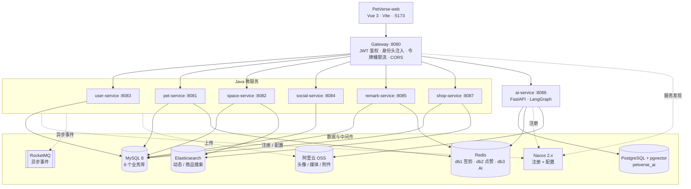

<div align="center">

# PetVerse · 宠域

**Java + Python 混合微服务的宠物社区平台后端**

虚拟宠物养成 · 真实宠物档案 · 宠域空间 · 好友私聊 · 点赞评论 · 周边商城 · AI 养宠顾问

[](https://openjdk.org/)
[](https://spring.io/projects/spring-boot)
[](https://spring.io/projects/spring-cloud)
[](https://www.python.org/)
[](https://fastapi.tiangolo.com/)
[](https://www.langchain.com/langgraph)
[](https://vuejs.org/)
[](#参与贡献)

[项目简介](#项目简介) · [快速开始](#快速开始) · [系统架构](#系统架构) · [AI 服务](#ai-服务) · [接口约定](#接口约定) · [文档索引](#文档索引)

**前端仓库**：[374426703/PetVerse-web](https://github.com/374426703/PetVerse-web)

</div>

---

## 项目简介

PetVerse（宠域）是一个面向宠物爱好者的社区平台后端，覆盖 **虚拟宠物养成、真实宠物档案、宠域空间（社区动态）、好友与聊天、点赞评论通知、宠物周边商城、AI 养宠问询** 七大业务域。

项目采用 **Java + Python 混合微服务**：Spring Cloud Gateway 统一入口，JWT 鉴权后向 Java / Python 两侧透传用户身份；6 个 Java 业务服务各自独立数据库，通过 Nacos 完成注册发现与配置下发，RocketMQ 驱动异步链路。AI 能力由独立的 Python 服务（FastAPI + LangGraph）承载，经网关 `/api/ai/**` 统一对外，是项目的核心投入方向。

> 本仓库为后端（含 `ai-service`）。前端位于独立仓库 [PetVerse-web](https://github.com/374426703/PetVerse-web)，使用 Vue 3 + Vite + Element Plus。

### 功能一览

| 业务域 | 主要能力 |
|---|---|
| 账号与身份 | 注册 / 登录（JWT）、资料与头像、`USER` / `MERCHANT` / `ADMIN` 三角色、商家审批通过后自动升级角色 |
| 虚拟宠物 | 领养与图鉴、等级 / 经验 / 升级结转、每日签到（Redis BitMap）、身份卡、改名与头像、动态奖励经验 |
| 真实宠物 | 宠物档案、健康信息（体重 / BCS / 疫苗 / 驱虫 / 病史等）、身份卡签发 |
| 宠域空间 | 图文 / 视频动态、多话题、公开 / 仅好友 / 仅自己三层可见性、热度榜、Elasticsearch 全文检索、点赞评论聚合 |
| 好友与聊天 | 好友申请 / 同意 / 拒绝 / 删除、一对一私聊（文本 / 图片 / 文件）、会话未读与历史消息 |
| 互动 | 通用点赞 / 评论 / 站内通知，以 `targetType + targetId` 定位对象，当前接入宠域空间动态 |
| 周边商城 | 商家入驻审核、店铺与商品管理、购物车、下单、模拟支付与取货码、超时取消、商品评价与商家回复、ES 商品搜索 |
| AI 养宠顾问 | SSE 流式对话、混合检索 RAG、短期 / 长期记忆、用户数据工具、多模态附件、健康评估、评论摘要、个性化推荐、知识库管理 |

---

## 系统架构



前端只访问网关，网关路由带 `StripPrefix=1`，业务服务内部路径不含 `/api` 前缀。

### 技术栈

| 层面 | 选型 |
|---|---|
| 后端主体 | Java 21 · Spring Boot 3.4.13 · Spring Cloud 2024.0.3 · Spring Cloud Alibaba 2023.0.3.4 · Spring Cloud Gateway · OpenFeign |
| 数据访问 | MyBatis-Plus 3.5.9 · MySQL 8 |
| 认证与安全 | JJWT 0.12.7 · BCrypt · 网关统一鉴权与角色校验 |
| 中间件 | Nacos 2.x · Redis · RocketMQ · Elasticsearch 8.15.5 |
| AI 服务 | Python 3.12 · FastAPI · LangGraph 1.x · LangChain 1.x · OpenAI 兼容 LLM / Embedding |
| 向量与缓存 | PostgreSQL + pgvector · Redis 热缓存 + PostgreSQL 温缓存 |
| 对象存储 | 阿里云 OSS |
| 前端 | Vue 3.5 · Vite 5 · Element Plus 2.14 · Axios · DOMPurify |
| 构建 | Maven 3.9+ · Vite |

---

## 快速开始

### 环境要求

| 组件 | 版本 | 本地默认 | 必要性 |
|---|---|---|---|
| JDK | 21 | — | 必须 |
| Maven | 3.9+ | — | 必须（仓库未包含 `mvnw` 脚本，请使用本机 Maven） |
| Nacos | 2.x | `localhost:8848` | 必须（服务注册 + 配置中心） |
| MySQL | 8 | `localhost:3306`，`root / 123456` | 必须（6 个业务库） |
| Redis | 5+ | `localhost:6379`，密码 `123456` | 推荐（签到、点赞、AI 缓存） |
| PostgreSQL + pgvector | 已安装 `vector` 扩展 | `localhost:5432`，库 `petverse_ai` | AI 功能必须 |
| Python | 3.12 | — | AI 服务必须 |
| Node.js | `^18` 或 `>=20` | — | 前端必须 |
| RocketMQ | — | `localhost:9876` | 可选，异步链路需要 |
| Elasticsearch | 8.15.5 | `localhost:9200` | 可选，搜索降级 MySQL |
| 阿里云 OSS | — | 桶 `petverse-me` | 可选，上传功能需要 |

> 仓库暂未提供 Docker Compose，请自行准备中间件（本地安装或自建容器）。

### 1. 克隆代码

```bash
git clone https://github.com/374426703/PetVerse.git
git clone https://github.com/374426703/PetVerse-web.git
```

### 2. 初始化 MySQL

先创建 6 个业务库（字符集 `utf8mb4`）：

```sql
CREATE DATABASE IF NOT EXISTS petverse_user   DEFAULT CHARACTER SET utf8mb4;
CREATE DATABASE IF NOT EXISTS petverse_pet    DEFAULT CHARACTER SET utf8mb4;
CREATE DATABASE IF NOT EXISTS petverse_space  DEFAULT CHARACTER SET utf8mb4;
CREATE DATABASE IF NOT EXISTS petverse_social DEFAULT CHARACTER SET utf8mb4;
CREATE DATABASE IF NOT EXISTS petverse_remark DEFAULT CHARACTER SET utf8mb4;
CREATE DATABASE IF NOT EXISTS petverse_shop   DEFAULT CHARACTER SET utf8mb4;
```

再执行各服务自带的建表脚本（共 21 张业务表，脚本可重复执行）：

```bash
mysql -u root -p petverse_user   < user-service/src/main/resources/db/schema.sql
mysql -u root -p petverse_pet    < pet-service/src/main/resources/db/schema.sql
mysql -u root -p petverse_space  < space-service/src/main/resources/db/schema.sql
mysql -u root -p petverse_social < social-service/src/main/resources/db/schema.sql
mysql -u root -p petverse_remark < remark-service/src/main/resources/db/schema.sql
mysql -u root -p petverse_shop   < shop-service/src/main/resources/db/schema.sql
```

各服务默认连接 `localhost:3306`、`root / 123456`，可通过 `MYSQL_URL` / `MYSQL_USERNAME` / `MYSQL_PASSWORD` 覆盖。

### 3. 初始化 PostgreSQL（AI 服务）

```bash
psql -U postgres -c "CREATE DATABASE petverse_ai;"
psql -U postgres -d petverse_ai -f ai-service/db/schema_pgvector.sql
```

`schema_pgvector.sql` 会创建 pgvector 扩展、会话 / 消息、知识库、健康报告与缓存表；LangGraph checkpoint 相关表由 AI 服务启动时幂等补建。使用前请确认 PostgreSQL 已安装 **pgvector**。

### 4. 导入 Nacos 配置

所有 Java 服务的端口、数据源、Redis、OSS、JWT、RocketMQ、网关路由等配置均由 Nacos 下发，**启动前必须先导入**。配置模板位于 `nacos-config/`（共 7 份）：

- dataId = 文件名去掉 `.yml`（如 `gateway-service`、`user-service`）
- group = `DEFAULT_GROUP`
- 格式 = YAML

```bash
# Windows
powershell -ExecutionPolicy Bypass -File ./nacos-config/push-to-nacos.ps1

# macOS / Linux
for file in nacos-config/*.yml; do
  data_id="$(basename "$file" .yml)"
  curl -s -X POST "http://localhost:8848/nacos/v1/cs/configs" \
    --data-urlencode "dataId=$data_id" \
    --data-urlencode "group=DEFAULT_GROUP" \
    --data-urlencode "type=yaml" \
    --data-urlencode "content@$file"
done
```

也可以登录 Nacos 控制台（`http://localhost:8848/nacos`）逐份新建配置并粘贴内容。

模板中的 JWT / OSS 密钥已脱敏为 `***********************`，启动前请通过环境变量注入：

```bash
# 网关与所有 Java 服务必须使用同一个密钥；长度至少 32 字节
export JWT_SECRET="please-change-me-to-a-random-32-byte-secret"
export OSS_ACCESS_KEY_ID="your-access-key-id"
export OSS_ACCESS_KEY_SECRET="your-access-key-secret"
```

> 自定义 Nacos 命名空间时，先设置 `NACOS_NAMESPACE` 再执行导入脚本，并在各服务 `bootstrap.yml` 的 discovery / config 下补充 `namespace`。详细步骤见 [docs/Nacos配置中心接入教程.md](docs/Nacos配置中心接入教程.md)。

### 5. 构建并启动 Java 服务

```bash
mvn clean install -DskipTests
```

可在 IDE 中分别启动各模块的 `*Application` 主类，或在多个终端中运行：

```bash
java -jar user-service/target/user-service-0.0.1-SNAPSHOT.jar
java -jar pet-service/target/pet-service-0.0.1-SNAPSHOT.jar
java -jar space-service/target/space-service-0.0.1-SNAPSHOT.jar
java -jar social-service/target/social-service-0.0.1-SNAPSHOT.jar
java -jar remark-service/target/remark-service-0.0.1-SNAPSHOT.jar
java -jar shop-service/target/shop-service-0.0.1-SNAPSHOT.jar
java -jar gateway-service/target/gateway-service-0.0.1-SNAPSHOT.jar
```

服务必须能从 Nacos 读取同名 dataId 配置，否则会因缺少端口、数据源等配置而启动失败。网关可随时启动，路由在请求时解析。

### 6. 启动 AI 服务

```bash
cd ai-service
python -m venv .venv

# Windows
.venv\Scripts\activate
# macOS / Linux
source .venv/bin/activate

pip install -r requirements.txt

# 复制环境变量样例，并按需填写 LLM / Embedding / PostgreSQL / Redis
# Windows: copy .env.example .env
cp .env.example .env

# 首次使用：导入内置养宠语料（RAG 必需）
python -m scripts.ingest_knowledge

# 启动服务（同时注册到 Nacos）
python -m uvicorn app.main:app --host 127.0.0.1 --port 8086
```

说明：

- 没有 LLM Key 时可设置 `MOCK_CHAT=true` 使用内置模拟回复；但知识类提问仍需要配置 `EMBEDDING_*`，否则会明确报错而不是无依据回答。
- LLM / Embedding 均为 OpenAI 兼容格式，改 `LLM_BASE_URL + LLM_MODEL` 即可切换服务商（如 DeepSeek、阿里云百炼）。
- 完整的配置项、知识库导入参数与接口列表见 [ai-service/README.md](ai-service/README.md)。

### 7. 启动前端

```bash
cd PetVerse-web
npm install
npm run dev
```

访问 `http://localhost:5173`。开发服务器会把 `/api` 代理到网关 `http://localhost:8080`。

### 8. 验证链路

```bash
# 注册（用户名 4-20 位字母 / 数字 / 下划线，密码 6-32 位）
curl -X POST http://localhost:8080/api/user/register \
  -H "Content-Type: application/json" \
  -d '{"username":"petlover","password":"123456","nickname":"铲屎官"}'

# 登录，响应 data.token 即 JWT
curl -X POST http://localhost:8080/api/user/login \
  -H "Content-Type: application/json" \
  -d '{"username":"petlover","password":"123456"}'

# 当前用户
curl http://localhost:8080/api/user/me \
  -H "Authorization: Bearer <token>"

# SSE 流式对话
curl -N -X POST http://localhost:8080/api/ai/chat/stream \
  -H "Authorization: Bearer <token>" \
  -H "Content-Type: application/json" \
  -d '{"message":"猫咪黑下巴怎么处理？","sessionId":null}'
```

---

## 目录结构

```text
PetVerse/
├── gateway-service/          # 统一入口：路由、JWT 鉴权、身份透传、限流
├── user-service/             # 用户与角色
├── pet-service/              # 虚拟宠物养成、真实宠物档案
├── space-service/            # 宠域空间动态、话题、搜索
├── social-service/           # 好友关系、私聊、聊天附件
├── remark-service/           # 通用点赞、评论、站内通知
├── shop-service/             # 商家、商品、购物车、订单、评价
├── petverse-common/          # 公共实体、统一返回、异常、JWT 上下文、MQ、OSS 等
├── ai-service/               # Python AI 服务
│   ├── app/
│   │   ├── graph/            # 对话 / 健康 / 评论 / 推荐编排图
│   │   ├── kb/               # 混合检索、切分、文档解析、BM25
│   │   └── knowledge/        # 内置养宠语料（md / pdf / docx）
│   ├── db/schema_pgvector.sql
│   ├── scripts/              # 知识库导入、RAG 评测、MySQL → PG 迁移
│   └── README.md
├── nacos-config/             # 7 份配置模板 + 一键导入脚本
├── docs/                     # 开发规范、Nacos 接入教程
└── pom.xml
```

## 模块说明

| 模块 | 端口 | 数据存储 | 职责 |
|---|---|---|---|
| `gateway-service` | 8080 | — | 路由转发、JWT 鉴权、剥离伪造身份头并重新注入、游客只读放行、`/internal/**` 拦截、角色校验、令牌桶限流、CORS |
| `user-service` | 8083 | MySQL `petverse_user` | 注册 / 登录、资料与头像、角色管理、内部批量查询；消费商家审批事件升级角色 |
| `pet-service` | 8081 | MySQL `petverse_pet` + Redis(db1) | 虚拟宠物等级 / 经验 / 签到、真实宠物档案与健康信息、品种图鉴、身份卡；消费动态事件发放经验 |
| `space-service` | 8082 | MySQL `petverse_space` + ES | 图文 / 视频动态、可见性、点赞评论聚合、热度榜、ES 全文检索与降级 |
| `social-service` | 8084 | MySQL `petverse_social` | 好友关系、私聊会话与消息、未读状态、聊天附件上传 |
| `remark-service` | 8085 | MySQL `petverse_remark` + Redis(db2) | 通用点赞 / 评论 / 通知；点赞 Redis 缓冲 + 脏标记 + 定时批量落库 |
| `shop-service` | 8087 | MySQL `petverse_shop` + ES | 商家入驻审核、店铺 / 商品、购物车、订单、评价回复、商品搜索 |
| `petverse-common` | — | — | 所有 DO / DTO / VO、统一返回与异常、JWT 上下文、Feign 身份透传、MQ 发布与去重、OSS 封装、MyBatis-Plus 与 Jackson 通用配置 |
| `ai-service` | 8086 | PostgreSQL `petverse_ai` + Redis(db3) | AI 对话、RAG、双层记忆、健康评估、评论摘要、个性化推荐、知识库管理 |

---

## AI 服务

AI 能力由独立的 Python 服务承载：FastAPI 提供 SSE 流式接口，LangGraph 负责多路上下文编排，服务启动后自注册到 Nacos，由网关按 `lb://ai-service` 发现并转发。

| 能力 | 说明 | 编排图 |
|---|---|---|
| AI 养宠顾问 | 意图识别 → RAG 检索 / 工具调用 → 生成；SSE 流式、多会话、多模态附件 | `app/graph/chat_graph.py` |
| 健康智能评估 | 基于宠物档案与健康信息生成评分、风险、养护计划与提醒 | `app/graph/health_graph.py` |
| 商品评论摘要 | 汇总真实评论生成口碑概览（情感 / 优缺点 / 关键词） | `app/graph/review_graph.py` |
| 个性化推荐 | 结合宠物画像、订单、购物车、评价、动态重排推荐 | `app/graph/recommend_graph.py` |

### 核心设计

- **对话编排**：意图分闲聊 / 知识 / 健康 / 急症 / 查数据五类，按意图条件路由；只有知识类才走检索、查数据类才启用 Agent 工具，最终 Prompt 由人设、宠物档案、长期记忆、RAG 知识、工具数据与医疗护栏按需拼装。
- **混合检索 RAG**：pgvector 余弦召回 + jieba BM25 关键词召回双通道融合，支持多轮问句改写、按物种降权 / 过滤与引用来源标注。内置 23 篇语料（约 6.4 万字 / 174 个片段），在 83 条黄金查询上 hit@1 达到 **92.8%**、MRR **0.948**。
- **双层记忆**：短期的 LangGraph checkpoint 以 `用户:会话` 为 `thread_id` 持久化每轮上下文；长期记忆使用官方 runtime store，按用户级 / 宠物级命名空间隔离，每轮结束后由后台任务抽取偏好、习性与病史。
- **中断恢复**：用户点击「停止生成」时，用 `aupdate_state` 将问题与已产出内容（标记 `interrupted`）补写回图状态，并经 PostgreSQL 兜底落库，避免「暂停即失忆」；用户消息即使零产出也会保存。
- **Agent 工具**：模型可自主调用「我的宠物 / 订单 / 购物车 / 商品评论 / 热门动态 / 搜索商品」等只读工具；工具按请求动态构建并闭包绑定 `user_id`，从设计上杜绝越权查询。
- **安全护栏**：命中疾病 / 用药 / 急症意图时强制附加就医提示，不做诊断替代；健康、评论、推荐三张图在 LLM 不可用时均有规则兜底。
- **韧性设计**：全局与单用户两级并发闸、SSE 15s 心跳、首帧静默重试、Redis + PostgreSQL 两级结果缓存（单飞 + TTL 抖动）、存储层降级与断线自愈。

更完整的实现细节、配置项与接口说明见 [ai-service/README.md](ai-service/README.md)。

---

## 配置说明

Java 服务的业务配置集中在 Nacos；本地 `application.yml` 仅声明配置导入，密钥类配置统一使用 `${环境变量:占位默认值}`。优先级为 **环境变量 > Nacos 配置 > 本地默认值**。

| 变量 / 配置项 | 作用范围 | 说明 |
|---|---|---|
| `NACOS_SERVER_ADDR` | 全部 Java 服务 | Nacos 地址，默认 `localhost:8848` |
| `MYSQL_URL` / `MYSQL_USERNAME` / `MYSQL_PASSWORD` | 各业务服务 | 各服务默认连接各自的 `petverse_*` 库 |
| `REDIS_HOST` / `REDIS_PORT` / `REDIS_PASSWORD` | pet / remark | pet 使用 db1，remark 使用 db2 |
| `JWT_SECRET` | 网关 + 全部服务 | 必须一致，至少 32 字节；默认值仅为脱敏占位 |
| `JWT_EXPIRE_SECONDS` | user-service | 令牌有效期，默认 86400 秒 |
| `OSS_ENDPOINT` / `OSS_ACCESS_KEY_ID` / `OSS_ACCESS_KEY_SECRET` / `OSS_BUCKET_NAME` | 需要上传的服务 | 共用同一个 OSS 桶 |
| `OSS_DOMAIN` | user / space | 自定义或 CDN 域名，为空时使用桶默认域名 |
| `petverse.search.enabled` | space / shop | 搜索总开关，`false` 时全部走 MySQL 模糊查询 |
| `petverse.order.pay-timeout-minutes` | shop-service | 支付超时分钟数，映射到 RocketMQ 延迟档位 |
| `petverse.gateway.rate-limit.*` | gateway-service | 令牌桶参数，AI 流式接口使用独立小桶 |
| `auth.whitelist-paths` / `auth.public-get-paths` | gateway-service | 免鉴权白名单、游客可读 GET 接口 |

AI 服务使用独立的 `.env`：LLM / Embedding / PostgreSQL / Redis / 业务服务地址 / RAG 参数等，完整列表见 [ai-service/.env.example](ai-service/.env.example)。

---

## 接口约定

所有客户端请求统一走网关 `http://localhost:8080/api/**`。

| 前缀 | 服务 | 说明 |
|---|---|---|
| `/api/user/**` | user-service | 注册、登录、资料、头像 |
| `/api/pet/**` | pet-service | 宠物领养、档案、签到、图鉴 |
| `/api/space/**` | space-service | 动态、媒体、搜索、热度榜 |
| `/api/social/**` | social-service | 好友、私聊、会话 |
| `/api/remark/**` | remark-service | 点赞、评论、通知 |
| `/api/shop/**` | shop-service | 商品、购物车、订单、评价、商家 |
| `/api/ai/**` | ai-service | SSE 对话、健康评估、评论摘要、推荐、知识库管理 |

### 统一响应

```json
{
  "code": 200,
  "msg": "操作成功",
  "data": {}
}
```

- 业务接口统一使用 `Result<T>` / `Result<PageResult<T>>`；参数校验失败返回 HTTP 400，未捕获异常返回 HTTP 500，网关鉴权失败返回 HTTP 401 / 403。
- 分页请求统一使用 `pageNum` / `pageSize`（从 1 开始，单页最大 100），返回 `{ total, pageNum, pageSize, records }`。
- 雪花 ID 为 19 位 Long，统一序列化为字符串下发，避免超过 JavaScript `Number.MAX_SAFE_INTEGER` 被截断。

### 鉴权与身份透传

- 除白名单与游客只读 GET 接口外，请求需携带 `Authorization: Bearer <token>`。
- 网关先剥离客户端自带的 `X-User-Id` / `X-User-Role`（防伪造），校验 JWT 后重新注入；下游服务通过 `UserContext` 获取当前用户。
- `/internal/**` 仅供服务间 Feign 调用，禁止经网关从外部访问；管理端 / 商家端接口按角色校验。
- 角色变更（如商家审批通过）后需要重新登录，令牌中的角色声明才会更新。

### SSE 事件

AI 对话流的事件顺序为 `meta → refs（有知识命中时）→ delta × n → done`，异常时发送 `error` 后结束；服务端每 15 秒发送心跳注释行，防止代理空闲断连。

---

## 工程亮点

- **网关安全闭环**：剥离伪造身份头 → 校验 JWT → 重新注入身份；游客只读接口按 Ant 精确匹配且仅 GET 放行；内部接口与角色路径统一拦截。
- **点赞最终一致**：点赞读写全走 Redis `Set`，变更打脏标记，定时任务增量 diff 后批量落库（批量插入 / 批量删除 / 计数快照），失败对象下轮重试。
- **订单一致性**：条件 SQL 原子扣库存防超卖，按商品 ID 升序扣减防死锁；延迟消息 + 支付 / 查询出口惰性取消双保险，仅抢占成功的一方回补库存。
- **事务后消息**：`MqEventPublisher` 通过事务同步器在 `afterCommit` 发送，避免「消息已发、事务回滚」的脏事件；消费端按业务键幂等去重。
- **ES 检索降级**：事务提交后发 MQ 异步刷索引，ES 只返回 ID 再回 MySQL 取权威数据；ES 异常进入 60s 熔断窗口并降级为 `LIKE` 查询。
- **AI 生产韧性**：RAG 检索不可用时明确报错而不降级编造；SSE 链路具备并发闸、心跳、首帧重试与存储层自愈；结果缓存采用「Redis 热 + PostgreSQL 温」两级兜底。
- **工程一致性**：DO / DTO / VO 集中在 `petverse-common`，Controller 只收 DTO、只返 `Result<VO>`；分页、主键、逻辑删除、异常处理与 ID 序列化规则统一。

---

## 中间件缺失时的行为

| 未启动 | 影响 |
|---|---|
| Nacos / MySQL | 服务无法启动或注册失败，必须先启动 |
| Redis | 点赞不可用或降级；签到由档案最近签到日期兜底；AI 缓存退化、单用户并发额度退化为进程内计数 |
| PostgreSQL | AI 会话持久化与记忆降级；知识库相关能力明确报错 |
| RocketMQ | 宠物经验、ES 索引同步、订单超时取消、商家角色升级等异步链路失效；发送侧自动降级为日志 |
| Elasticsearch | 动态 / 商品搜索降级为 MySQL 模糊查询，可设置 `petverse.search.enabled=false` 全局关闭 |
| 阿里云 OSS | 头像、动态媒体、商品图、聊天附件、AI 附件等上传功能不可用 |
| LLM / Embedding | 未配置 LLM 时可用 `MOCK_CHAT=true`；未配置 Embedding 时知识类提问明确报错 |

> RocketMQ 的消费端在 Broker 不可达时可能阻断对应服务启动；本地开发建议一并启动，或按需排除 RocketMQ 自动装配。

---

## 常见问题

**服务启动时报缺少端口 / 数据源配置**

未从 Nacos 读到同名 dataId。确认 Nacos 已启动、配置已导入、dataId 不带 `.yml` 后缀，且 `bootstrap.yml` 中的地址与命名空间正确。

**网关返回 401「未登录」或「登录已失效」**

检查 `Authorization` 头是否为 `Bearer <token>`；确认网关与所有服务使用同一个 `JWT_SECRET`；角色变更后需重新登录。

**AI 知识类提问直接报错**

通常是未配置 `EMBEDDING_*` 或知识库为空。配置 Embedding 后执行 `python -m scripts.ingest_knowledge`，再用 `--stats` 检查语料规模。

**上传头像 / 动态 / 商品图失败**

检查 `OSS_*` 环境变量是否注入到对应服务；Nacos 模板中的密钥是占位符，不能直接用于真实上传。

**搜索没有结果或行为异常**

确认 Elasticsearch 已启动且 `petverse.search.enabled=true`；索引依赖 RocketMQ 异步同步，Broker 不可用时新数据可能未进入索引。

**前端请求 404 / 502**

确认网关监听 8080、目标服务已在 Nacos 注册；前端开发环境下 `/api` 由 Vite 代理到 `http://localhost:8080`。

---

## 文档索引

| 文档 | 内容 |
|---|---|
| [docs/后端开发规范.md](docs/后端开发规范.md) | 模块职责、包结构、命名规范、分层调用、表结构约定 |
| [docs/Nacos配置中心接入教程.md](docs/Nacos配置中心接入教程.md) | Nacos 持久化、密钥脱敏、配置导入、命名空间与常见问题 |
| [ai-service/README.md](ai-service/README.md) | AI 服务环境变量、知识库导入、接口列表、RAG 评测与韧性设计 |
| [PetVerse-web](https://github.com/374426703/PetVerse-web) | Vue 3 前端仓库 |

---

## 参与贡献

欢迎通过 Issue 反馈问题、提交 Pull Request 改进项目。提交前建议：

1. 阅读 [docs/后端开发规范.md](docs/后端开发规范.md)，保持实体集中、分层调用与命名一致。
2. 若改动表结构，同步更新对应服务的 `db/schema.sql`，并将存量库迁移语句以注释形式补在文件头部。
3. 若新增 Nacos 配置项，同步更新 `nacos-config/` 模板并在本 README 的配置表中登记。
4. 不要提交真实密钥、`.env`、`*-local.yml` 或本地日志；`petverse-common` 的改动会影响全部服务，提交前请全量构建通过。
5. 项目暂未引入自动化测试，请至少通过 `curl` 或前端联调覆盖正常与异常分支。

## 已知边界与路线图

- 暂无自动化测试模块，目前以手工接口联调为主，后续计划补充单元测试与集成测试。
- 暂无 Docker Compose 一键启动脚本，中间件需要自行准备。
- 网关令牌桶、`MqDeduplicator` 内存去重、AI 全局并发信号量均为进程内状态，多实例部署需要外部化。
- 商城为模拟支付与到店自取，未对接真实支付网关与外送履约。
- RAG 语料目前通过脚本全量导入，长期记忆抽取依赖 LLM 输出质量，均存在进一步优化空间。

## 安全提示

- 仓库中的 Nacos 配置模板与 `ai-service/.env.example` **只包含脱敏占位符**，真实密钥请通过环境变量或 Nacos 控制台注入。
- `ai-service/.env`、`nacos-config/*-local.yml`、`secrets-local.yml` 与日志文件已在 `.gitignore` 中忽略。
- 若曾误提交真实密钥，请立即在对应服务商控制台轮换，并清理 Git 历史。
- 生产环境请修改默认数据库密码、使用强随机 `JWT_SECRET`，并为 OSS 配置最小权限的访问凭证。

## 许可证

本仓库目前尚未附带 `LICENSE` 文件，默认保留所有权利。开源许可证（如 MIT / Apache-2.0）待作者确认后补充；在此之前如需转载、商用或二次分发，请先通过 Issue 联系作者。

---

如果这个项目对你有帮助，欢迎 Star 支持。
